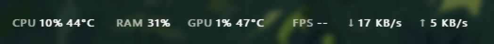

# TaskbarStatus

A tiny, text-only system monitor that lives inside the Windows 11 taskbar.



- **CPU** usage and temperature (via the [PawnIO](https://pawnio.eu) driver)
- **RAM** usage (% or GB)
- **GPU** usage and temperature (any vendor)
- **FPS** of the game / app in the foreground
- **Network** download / upload speed

Same font and weight as the taskbar clock, in one line or two. The widget is part of the taskbar itself, so it stays
sharp when the Start menu or other shell flyouts open. No window, no tray icon, ~90 KB.

[Türkçe açıklama aşağıda ↓](#türkçe)

## Install

```
winget install batuhanbecel.TaskbarStatus
```

Or download `TaskbarStatus-Setup-x.y.z.exe` from [Releases](../../releases).
The installer also installs the **PawnIO** driver (required, used for the CPU temperature) and sets TaskbarStatus up
to start with administrator rights at sign-in, without a UAC prompt.

A portable `TaskbarStatus.exe` is attached to each release too; it reads CPU temperature and FPS only when PawnIO is
installed and the app runs as administrator.

## Usage

| Action | What it does |
| --- | --- |
| **Right-click** | Windows 11 style menu: values to show, appearance, position, update rate, language, start with Windows, updates |
| **Drag** | Fine-tune the position along the taskbar (remembered) |
| **Hover** | Tooltip with details (GPU name, RAM in GB, FPS process, …) |
| **Double-click** | Open Task Manager |

**Menu highlights**

- *Show*: CPU usage, CPU temperature, RAM, GPU usage, GPU temperature, FPS, network speed (each on/off)
- *Appearance*: two lines like the clock, bold text, labels, highlight high values, RAM in GB, text size
- *Position*: next to the clock or at the left edge of the taskbar
- *Language / Dil*: Windows language, Türkçe, English
- *Updates*: check automatically, install automatically in the background, check now

Settings live in `HKCU\Software\TaskbarStatus`.

## Updates

TaskbarStatus checks GitHub Releases shortly after it starts and then every 6 hours. A new version is downloaded in the
background, verified against the SHA-256 digest GitHub publishes for the release asset, and installed silently; the app
restarts itself a few seconds later. Installs wait while a fullscreen app (a game) is in front.

Turn this off under *Updates → Install automatically in the background*; a found update then appears at the top of the
menu instead (and as a small dot after the text).

## How the values are measured

| Value | Source | Notes |
| --- | --- | --- |
| CPU % | `GetSystemTimes` | |
| CPU °C | PawnIO: AMD Zen `THM_TCON_CUR_TMP` (SMN), Intel `IA32_PACKAGE_THERM_STATUS` | Needs admin. Falls back to HWiNFO shared memory, LibreHardwareMonitor WMI, ACPI thermal zone |
| RAM | `GlobalMemoryStatusEx` | |
| GPU % | `GPU Engine` performance counters | Same method as Task Manager (busiest engine) |
| GPU °C | `D3DKMTQueryAdapterInfo` (adapter perf data) | Same source as Task Manager; WDDM 2.4+ driver |
| FPS | ETW, `Microsoft-Windows-DXGI` Present events | Needs admin. DirectX 10/11/12 and titles that present through DXGI |

## How it sits in the taskbar

The widget is a layered child window of `Shell_TrayWnd`, drawn with GDI ClearType text turned into per-pixel alpha.
Being a child of the taskbar keeps it above the taskbar's background and out of the blur Windows draws when Start opens.
If *Show over fullscreen apps* is on, it detaches into a topmost overlay while a fullscreen app is in front (the taskbar
hides itself then). When Explorer restarts, the widget goes away with the old taskbar and the app starts itself again.

## Building

No .NET SDK needed; the C# compiler that ships with Windows is used.

```bat
build.bat            :: TaskbarStatus.exe (downloads the PawnIO modules on first run)
build-installer.bat  :: dist\TaskbarStatus-Setup-x.y.z.exe (needs Inno Setup 6)
```

`TaskbarStatus.exe --dev` runs a second copy next to the installed one, with its own settings
(`HKCU\Software\TaskbarStatus.Dev`), no elevated-task hop and no update checks.

The version comes from `src/AssemblyInfo.cs`. Pushing a tag like `v1.2.3` makes GitHub Actions build, sign (if
configured), publish the release and submit the package to winget (if configured). Installed copies pick the release up
on their own within about 6 hours.

### Repository secrets

| Secret | Used for |
| --- | --- |
| `SIGN_CERT_PFX_BASE64`, `SIGN_CERT_PASSWORD` | Code signing (base64 of a `.pfx` code-signing certificate). Without them builds are unsigned |
| `WINGET_TOKEN` | GitHub token (classic, `public_repo`) used by `wingetcreate` to open the PR in `microsoft/winget-pkgs` |

## Credits

- [PawnIO](https://pawnio.eu) by namazso: driver and modules (LGPL-2.1), bundled unmodified.
- Temperature register details follow [LibreHardwareMonitor](https://github.com/LibreHardwareMonitor/LibreHardwareMonitor).

## License

[MIT](LICENSE)

---

## Türkçe

Windows 11 görev çubuğunun içinde duran, sadece yazıdan oluşan küçük bir sistem izleyici: CPU kullanımı ve sıcaklığı,
RAM, GPU kullanımı ve sıcaklığı, öndeki oyunun FPS değeri ve ağ hızı. Görev çubuğunun bir parçası olduğu için Başlat
menüsü açıldığında da net kalır.

**Kurulum:** `winget install batuhanbecel.TaskbarStatus` ya da [Releases](../../releases) sayfasından
`TaskbarStatus-Setup-x.y.z.exe`. Kurulum, CPU sıcaklığı için gereken **PawnIO** sürücüsünü de kurar ve uygulamayı
oturum açılınca UAC sormadan yönetici olarak başlatacak şekilde ayarlar.

**Kullanım:** Sağ tıkla Windows 11 tarzı menüyü aç: gösterilecek değerler, görünüm (iki satır, kalın yazı, yazı
boyutu…), konum (saatin yanı / görev çubuğunun solu), güncelleme sıklığı, dil (Windows dili / Türkçe / English),
Windows ile başlat, güncellemeler. Sürükleyerek ince ayar yap, üzerine gelince detayları gör, çift tıklayınca Görev
Yöneticisi açılır.

**Güncellemeler:** Uygulama açıldıktan kısa süre sonra ve her 6 saatte bir GitHub'a bakar. Yeni sürümü arka planda
indirir, GitHub'ın yayınladığı SHA-256 ile doğrular, sessizce kurar ve birkaç saniye içinde kendini yeniden başlatır.
Tam ekran bir oyun açıksa kurulum, oyundan çıkana kadar bekler. *Güncellemeler → Arka planda otomatik yükle* ile
kapatılabilir.

**Derleme:** `build.bat` (exe) ve `build-installer.bat` (kurulum, Inno Setup 6 gerekir). Kurulu sürümün yanında test
için `TaskbarStatus.exe --dev` kullanılabilir.
